# Make Paper-Ready Plots

A reusable agent skill for clean, reproducible **scientific paper figures in a consistent DIN style**.
Style guides, runnable Matplotlib templates, optional molecular 3D rendering, and PDF/PNG exports—with examples from real research.

**DIN 2014 is recommended.** Supply your own licensed fonts; DejaVu Sans is the fallback.

논문용 그래프 제작 스킬입니다. 실제 연구 그림과 재생성 가능한 DIN 샘플을 함께 제공합니다.

[Research gallery](#research-gallery) · [Templates](#reproducible-templates) · [3D rendering](#optional-3d-rendering) · [Use the skill](#use-the-skill) · [Sources & rights](#sources--rights)

## Research gallery

Original research figures retain their values, labels, and typography.
Click a manuscript preview to open its full PDF.

### Density matrix learning

<table>
<tr>
<td width="50%" align="center" valign="top">
<a href="examples/density-matrix/occupation-spectrum.pdf">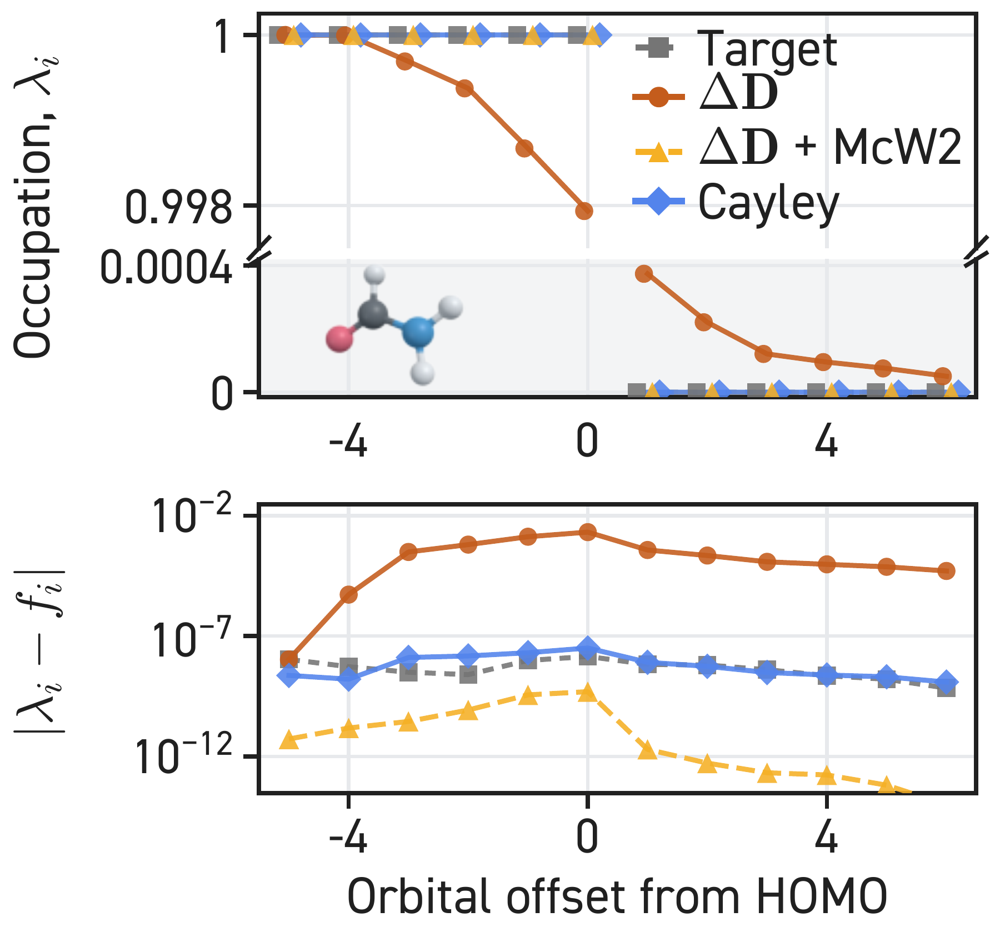</a><br>
<b>Occupation correction</b><br>Broken axes · spectral diagnostics
</td>
<td width="50%" align="center" valign="top">
<a href="examples/density-matrix/subspace-ablation.pdf">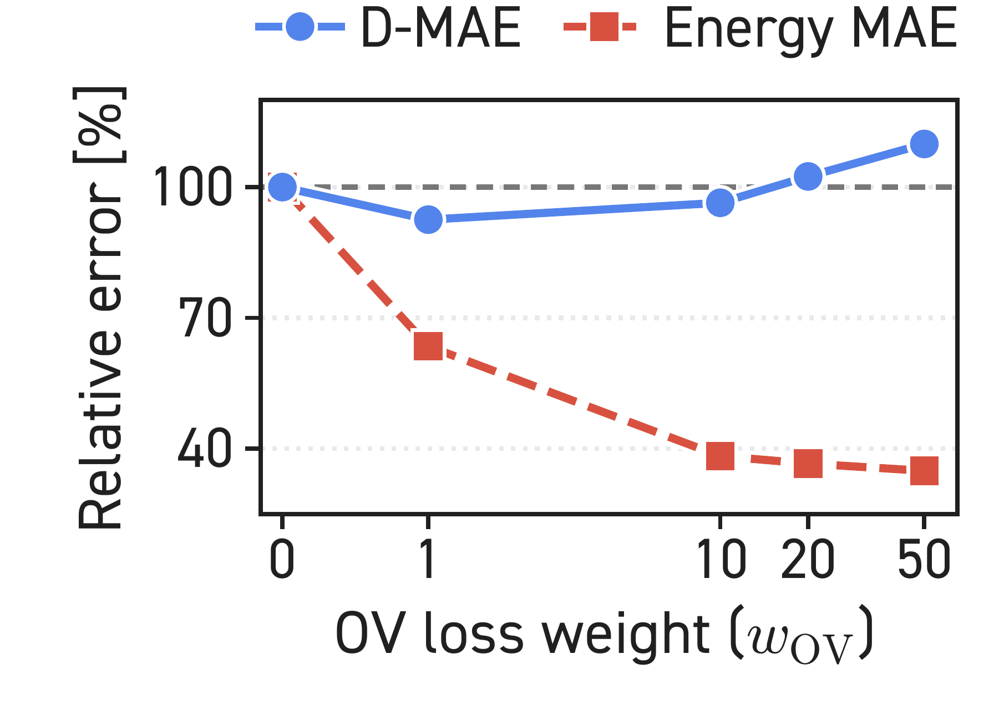</a><br>
<b>Subspace ablation</b><br>Two metrics · compact legend
</td>
</tr>
<tr>
<td width="50%" align="center" valign="top">
<a href="examples/density-matrix/inversion-sensitivity.pdf">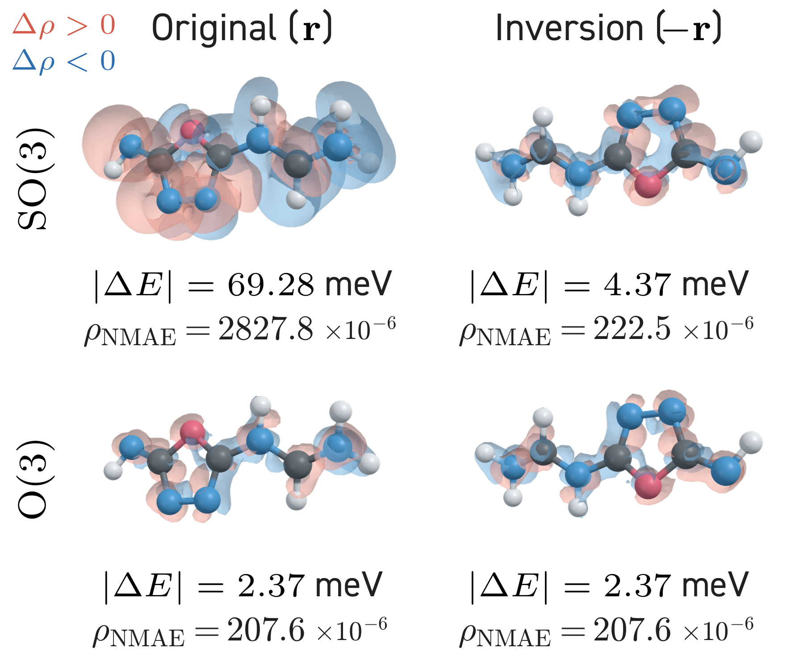</a><br>
<b>Inversion sensitivity</b><br>Matched molecular views · signed errors
</td>
<td width="50%" align="center" valign="top">
<a href="examples/density-matrix/density-errors.pdf">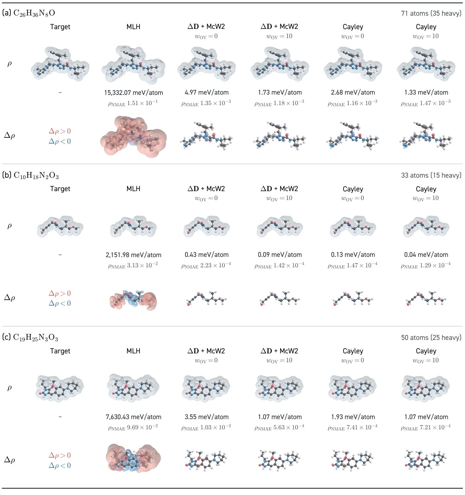</a><br>
<b>Density comparison</b><br>Multiple molecules · aligned method columns
</td>
</tr>
</table>

[All four figures & provenance](examples/density-matrix/README.md).
The source manuscript is private; these selected figure files are available here.
For new figures in these styles, use the [research style recipes](references/research-styles.md)
and [optional 3D renderer](references/rendering-3d.md). The original manuscript data pipeline is not bundled.

### QHFlow2

<table>
<tr>
<td width="50%" align="center" valign="top">
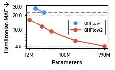<br>
<b>Model size → Hamiltonian error</b>
</td>
<td width="50%" align="center" valign="top">
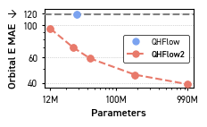<br>
<b>Model size → orbital-energy error</b>
</td>
</tr>
<tr>
<td width="50%" align="center" valign="top">
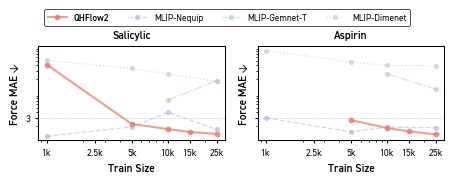<br>
<b>Data scaling · forces</b>
</td>
<td width="50%" align="center" valign="top">
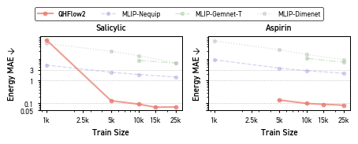<br>
<b>Data scaling · energies</b>
</td>
</tr>
</table>

[All six figures & source notebooks](examples/qhflow2/README.md).
These are unchanged notebook outputs, including small inline previews.

## Reproducible templates

**Synthetic data · DIN 2014 · Python + PDF + PNG.**
These examples demonstrate styling, not measured research results.

<a href="examples/gallery/small-multiples.pdf">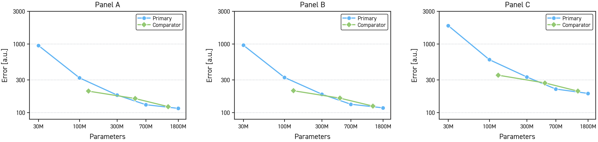</a>

**Small multiples** — shared scales, explicit ticks, and consistent panel legends.
[Template](assets/matplotlib-small-multiples.py) · [PDF](examples/gallery/small-multiples.pdf)

<table>
<tr>
<td width="33%" align="center" valign="top">
<a href="examples/gallery/compact-boxed.pdf">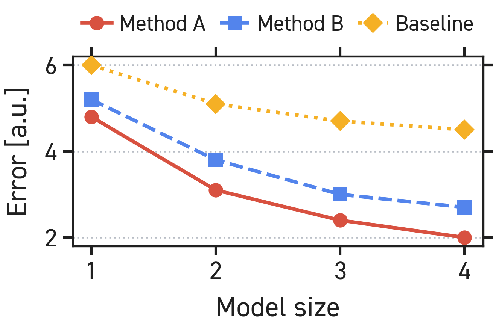</a><br>
<b>Compact boxed</b><br>Thin axes · horizontal legend
</td>
<td width="33%" align="center" valign="top">
<a href="examples/gallery/ablation.pdf">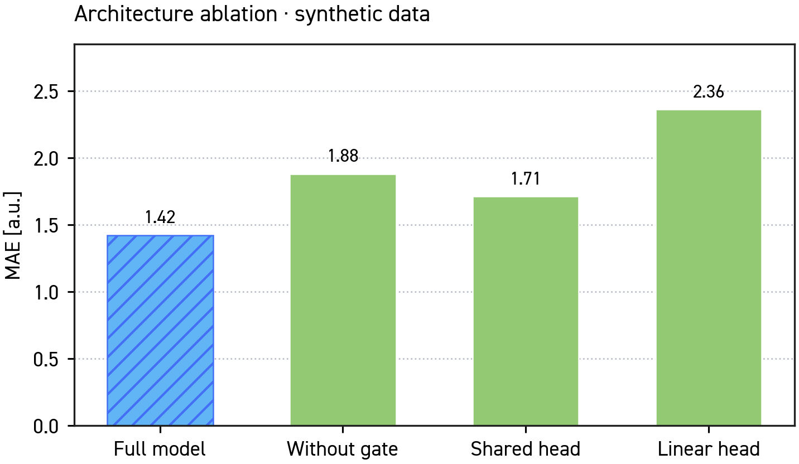</a><br>
<b>Ablation</b><br>Zero-based bars · direct labels
</td>
<td width="33%" align="center" valign="top">
<a href="examples/gallery/scaling-fit.pdf">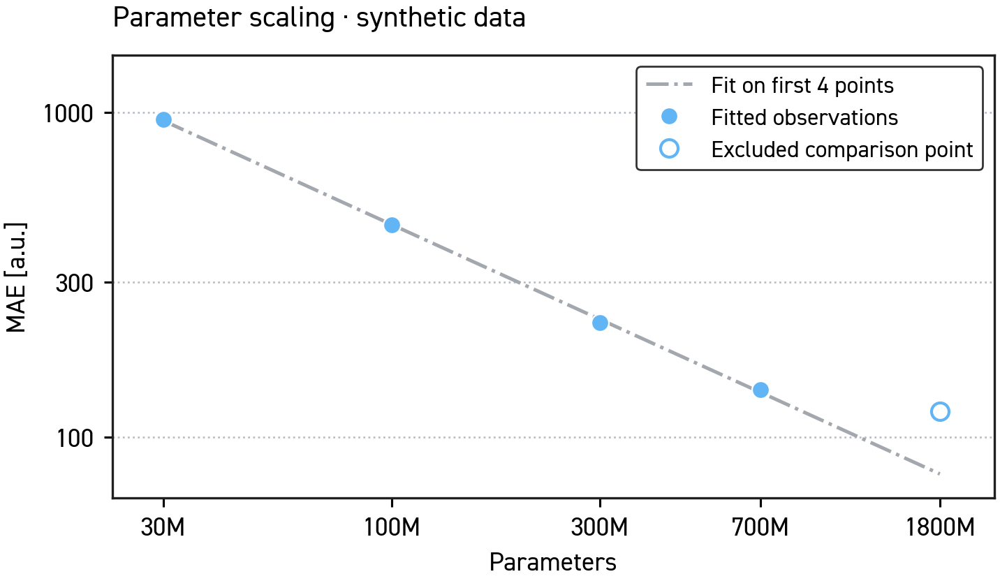</a><br>
<b>Scaling fit</b><br>Explicit fit selection · open marker
</td>
</tr>
</table>

[Compact template](assets/matplotlib-din-boxed.py) · [Gallery source](examples/generate_gallery.py)

## Optional 3D rendering

**Runnable PyVista/VTK renderer · synthetic fields · DIN 2014 labels.**

<a href="examples/molecular-3d/overview.pdf">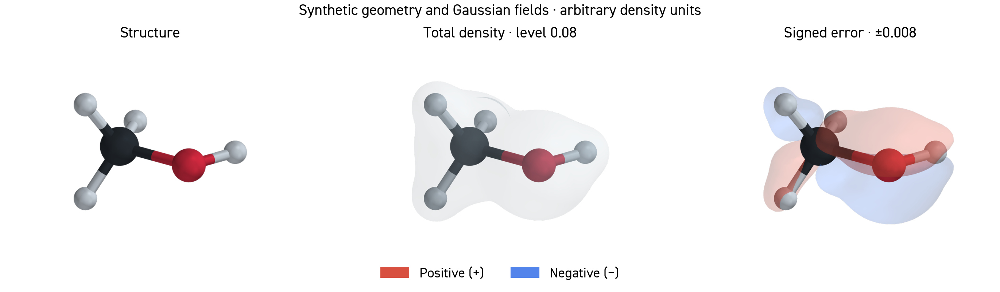</a>

Render ball-and-stick structures, alpha/beta/total density, spin density, and
signed prediction errors from atom coordinates and a supplied 3D grid. Set
contour levels, opacity, transparent background, resolution, and a shared camera.
Every PNG comes with a JSON manifest recording units, sign convention, camera,
thresholds, rendering settings, and input/output hashes.

```bash
python -m pip install -r requirements-3d.txt
python examples/generate_molecular_gallery.py --font /path/to/DIN2014-Regular.ttf
```

Omit `--font` for DejaVu Sans. Optional system OpenGL support is needed for 3D;
see [environment setup](references/rendering-3d.md#rendering-environment).

[Five-panel density channels](examples/molecular-3d/channels.png) ·
[Example source](examples/generate_molecular_gallery.py) ·
[Input format & options](references/rendering-3d.md) ·
[Demo details](examples/molecular-3d/README.md)

These are synthetic Gaussian fields, **not DFT or model results**. For your own
figures, supply scientifically computed fields on a common grid. The renderer
does not calculate a density from an AO matrix or regenerate the original
manuscript figures. The PDF composition embeds raster 3D panels with vector labels.

## Use the skill

```bash
git clone https://github.com/seongsukim-ml/make-paper-ready-plots.git
```

Ask your agent to read [`SKILL.md`](SKILL.md), then describe your data and figure:

> Follow make-paper-ready-plots/SKILL.md. Plot the MAE results from results.csv
> as three comparable panels with shared scales. Use my licensed DIN 2014 font,
> preserve the supplied values, and deliver the Python script, PDF, and PNG.

For compact plots, request the **DIN Boxed** profile. Power-law fits are optional
and only added when requested. For molecular figures, ask:

> Follow the optional 3D workflow. Render my NPZ structure, total density and
> prediction-minus-reference error. Use fixed contour levels and one shared
> camera, a transparent background, and DIN labels in the final comparison.

<details>
<summary>Install as a personal Codex skill</summary>

Clone into an unused skill folder:

```bash
git clone https://github.com/seongsukim-ml/make-paper-ready-plots.git \
  "${CODEX_HOME:-$HOME/.codex}/skills/make-paper-ready-plots"
```

If that directory already exists, compare using a separate checkout first.
Once discovered by your agent, invoke `$make-paper-ready-plots`.

</details>

## Run the templates

Python 3.10+. No LaTeX installation or image-generation API is needed.

```bash
python -m venv .venv
source .venv/bin/activate
python -m pip install -r requirements.txt
python examples/generate_gallery.py \
  --font /path/to/DIN2014-Regular.ttf --bold-font /path/to/DIN2014-Bold.ttf
```

Omit the font arguments to use DejaVu Sans. This regenerates the **four synthetic
examples only** and checks PNG integrity, dimensions, PDF page count, and font
names. Inspect layout at the intended paper size as well.

<details>
<summary>Run individual templates and validate exports</summary>

```bash
python assets/matplotlib-small-multiples.py --output-stem output/comparison
python assets/matplotlib-din-boxed.py --output-stem output/compact \
  --font /path/to/DIN2014-Regular.ttf --bold-font /path/to/DIN2014-Bold.ttf
python scripts/validate_static_plot.py output/compact.png output/compact.pdf
```

The validator performs basic file checks; it does not establish statistical
correctness, accessibility, or publisher compliance.

</details>

## Sources & rights

| Resource | Contents |
|---|---|
| [SKILL.md](SKILL.md) | Agent workflow |
| [Default style](references/style-guide.md) · [DIN Boxed](references/din-boxed.md) | Typography, axes, colors, and export conventions |
| [Research styles](references/research-styles.md) | Occupation spectra, ablations, and molecular comparison layouts |
| [3D workflow](references/rendering-3d.md) | Optional renderer, input schema, camera, contour levels, and validation |
| [Power-law guide](references/power-law.md) | Optional descriptive fits |
| [Density matrix gallery](examples/density-matrix/README.md) | Four manuscript figures, original PDFs, and source hashes |
| [QHFlow2 gallery](examples/qhflow2/README.md) | Six archived figures and extraction provenance |

The original skill, scripts, and synthetic examples use the [MIT license](LICENSE).
Manuscript figures have [separate rights](examples/density-matrix/NOTICE.md).
See [third-party notices](THIRD_PARTY_NOTICES.md) for attribution and fonts.
DIN font files are not distributed.
