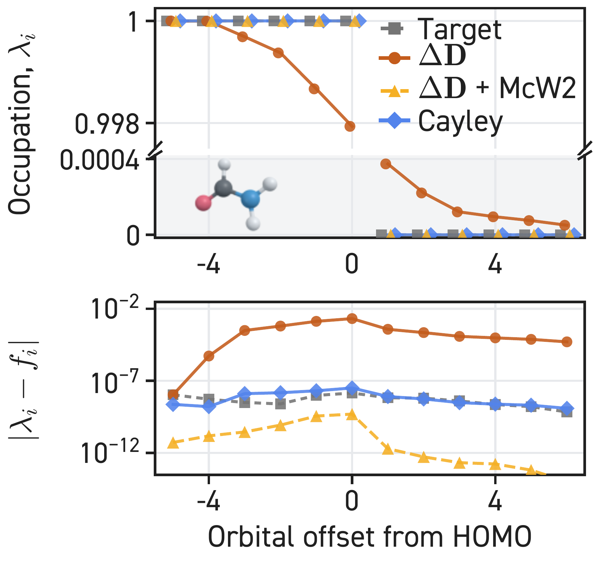
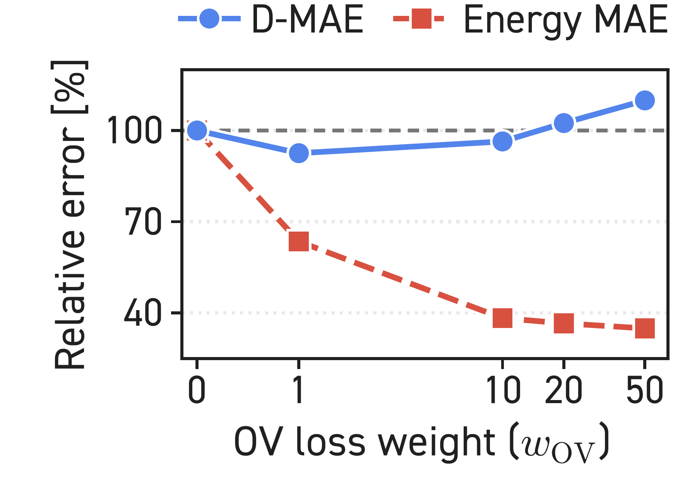
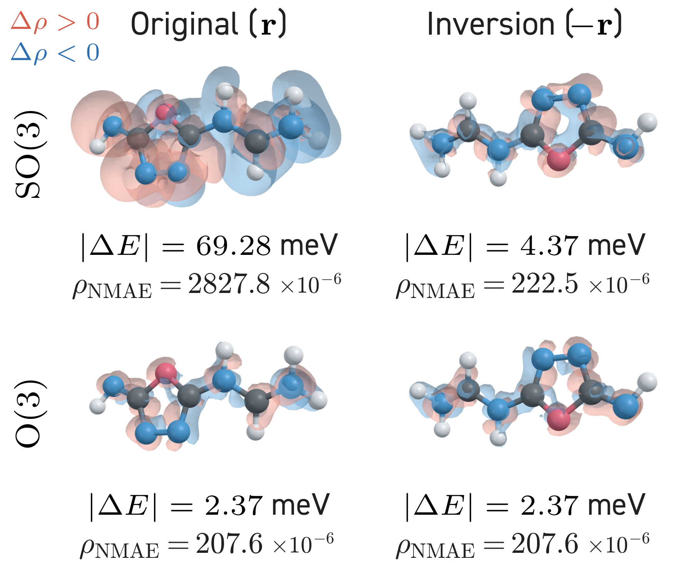
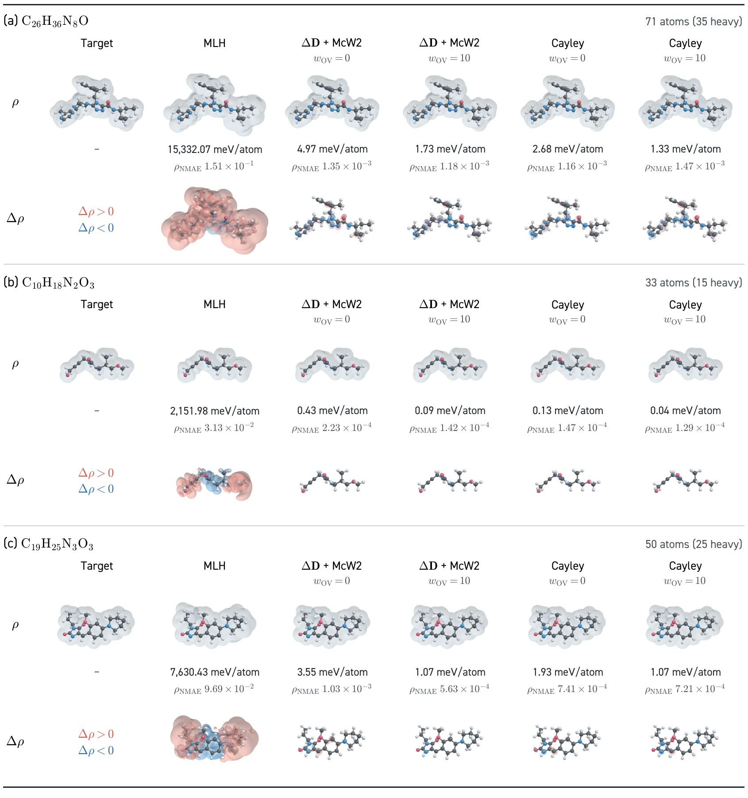

# Density matrix learning: manuscript examples

Selected figures used in the main text and appendix of *Spectrally Constrained
Electronic Density Matrix Learning with Subspace Alignment*. These are original
research figures, not synthetic examples or newly evaluated results.

The PDFs are unchanged originals; PNGs are page renders for the gallery.
Click a preview to open the full PDF. These molecular visualizations are
composition references. The [optional 3D workflow](../../references/rendering-3d.md)
can create new renders from supplied grids; it does not reproduce the private
manuscript pipeline. See [style recipes](../../references/research-styles.md)
for occupation plots, ablations, and matched molecular comparisons.

## Figures

### Occupation correction

[Original source](https://github.com/seongsukim-ml/density_matrix_learning_draft2/blob/cf2d2de365b150ef96380038f2f38b0bd8dc1627/figure/qh9_occupation_wrap.pdf) · [Manuscript inclusion](https://github.com/seongsukim-ml/density_matrix_learning_draft2/blob/cf2d2de365b150ef96380038f2f38b0bd8dc1627/figure/occupation_correction_wrap.tex)

### OV-weight ablation

[Original source](https://github.com/seongsukim-ml/density_matrix_learning_draft2/blob/cf2d2de365b150ef96380038f2f38b0bd8dc1627/figure/qh9_ov_ablation_mcw2.pdf) · [Manuscript inclusion](https://github.com/seongsukim-ml/density_matrix_learning_draft2/blob/cf2d2de365b150ef96380038f2f38b0bd8dc1627/figure/qh9_ov_ablation.tex)

### Inversion sensitivity

[Original source](https://github.com/seongsukim-ml/density_matrix_learning_draft2/blob/cf2d2de365b150ef96380038f2f38b0bd8dc1627/figure/cayley_inversion_wrap.pdf) · [Manuscript inclusion](https://github.com/seongsukim-ml/density_matrix_learning_draft2/blob/cf2d2de365b150ef96380038f2f38b0bd8dc1627/figure/cayley_inversion_wrap.tex)

### QM40 electron densities and signed errors

[Original source](https://github.com/seongsukim-ml/density_matrix_learning_draft2/blob/cf2d2de365b150ef96380038f2f38b0bd8dc1627/figure/qm40_prediction_density_errors.pdf) · [Manuscript inclusion](https://github.com/seongsukim-ml/density_matrix_learning_draft2/blob/cf2d2de365b150ef96380038f2f38b0bd8dc1627/sections/appendix_qm40_results.tex)

## Source and reuse

The source repository is private, so its links require access. The selected
figure files in this public gallery can be viewed without that access.
[`sources.json`](sources.json) records the snapshot, original paths, manuscript
inclusion points, and SHA-256 checksums. See [NOTICE.md](NOTICE.md) for reuse
conditions; these manuscript assets are not covered by the skill’s MIT license.
