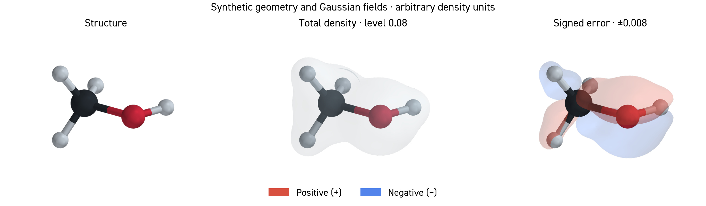
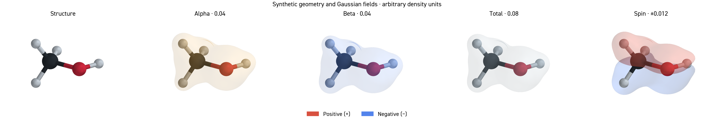

# Molecular rendering demo

**Synthetic methanol-like geometry and analytic Gaussian fields.** These are
illustrations of a rendering style, not measured densities, DFT calculations,
or model evaluations. All field values use arbitrary units.

[](overview.pdf)

[](channels.pdf)

## Reproduce

From the repository root:

```bash
python -m pip install -r requirements-3d.txt
python examples/generate_molecular_gallery.py --font /path/to/DIN2014-Regular.ttf
```

Omit `--font` to use DejaVu Sans. The checked-in compositions use locally supplied
DIN 2014, recorded in `typography.json`; font binaries are excluded. For this
release the demo was rendered with PyVista 0.46.5 and VTK 9.5.2. Rendering can
vary slightly with the graphics backend; inspect the manifests for exact settings.

The generator creates `synthetic-fields.npz`, one shared `camera.json`, and:

| Render | Field | Contours | Opacity |
|---|---|---|---|
| `structure.png` | atoms and supplied bonds | — | opaque atoms |
| `alpha.png` | alpha | 0.04 | 0.38 |
| `beta.png` | beta | 0.04 | 0.38 |
| `total.png` | alpha + beta | 0.08 | 0.38 |
| `spin.png` | alpha − beta | ±0.012 | 0.52 |
| `error.png` | synthetic prediction − reference | ±0.008 | 0.52 |

The perturbations are defined explicitly in
[`generate_molecular_gallery.py`](../generate_molecular_gallery.py). All panels
share the same camera, physical scale, grid, geometry, lighting and zero smoothing.
The generator checks camera equality. Red surfaces are positive, blue negative;
the shell color does not encode magnitude beyond the labeled contour level.

Each 900 × 650 RGBA PNG has a same-stem JSON containing input/output hashes,
units, field definition, camera, levels, surface checks, and engine settings.
`overview` and `channels` are PNG/PDF compositions. Their PDF labels are vector
text; molecular panels are embedded raster images. Raise render dimensions for
larger print sizes. Generated white/black alpha inspection images are excluded
from Git; they can be regenerated with the same command.

For real data, see the [input schema and workflow](../../references/rendering-3d.md).
Original demo source and generated synthetic assets are MIT licensed. They are
separate from the research figures with their own provenance and rights notices.
