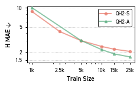
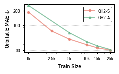

# Original QHFlow2 figures

These are archived research figure outputs from the public
[QHFlow2 repository](https://github.com/seongsukim-ml/QHFlow2). They are provided
as visual references alongside this skill. They are not synthetic data and
do not represent a new benchmark run or a current-model performance claim.

Source snapshot: [`67af4bfe4994`](https://github.com/seongsukim-ml/QHFlow2/tree/67af4bfe499459039cd2a9b4b3cd7ff3dbc04bd5).
PNG bytes were decoded from stored notebook outputs without executing cells,
changing values, relabeling methods, or resizing images. Small PNGs retain the
original inline-preview resolution; no vector version is implied. The SCF
panels retain their original DejaVu Sans typography.

| Figure | Original notebook | Cell / output (zero-based) |
|---|---|---|
| [Parameter count vs Hamiltonian MAE](parameter-hamiltonian.png) | [Source](https://github.com/seongsukim-ml/QHFlow2/blob/67af4bfe499459039cd2a9b4b3cd7ff3dbc04bd5/_asset/param_vs_performance/param_new.ipynb) | 3 / 0 |
| [Parameter count vs orbital energy MAE](parameter-orbital-energy.png) | [Source](https://github.com/seongsukim-ml/QHFlow2/blob/67af4bfe499459039cd2a9b4b3cd7ff3dbc04bd5/_asset/param_vs_performance/param_new.ipynb) | 4 / 0 |
| [MD17 training size vs force MAE](md17-force.png) | [Source](https://github.com/seongsukim-ml/QHFlow2/blob/67af4bfe499459039cd2a9b4b3cd7ff3dbc04bd5/_asset/md17_datascaling/data_scaling_v2.ipynb) | 2 / 0 |
| [MD17 training size vs energy MAE](md17-energy.png) | [Source](https://github.com/seongsukim-ml/QHFlow2/blob/67af4bfe499459039cd2a9b4b3cd7ff3dbc04bd5/_asset/md17_datascaling/data_scaling_v2.ipynb) | 2 / 2 |
| [MD17 training size vs Hamiltonian MAE](md17-hamiltonian.png) | [Source](https://github.com/seongsukim-ml/QHFlow2/blob/67af4bfe499459039cd2a9b4b3cd7ff3dbc04bd5/_asset/md17_datascaling/data_scaling_v2.ipynb) | 2 / 4 |
| [MD17 training size vs orbital energy MAE](md17-orbital-energy.png) | [Source](https://github.com/seongsukim-ml/QHFlow2/blob/67af4bfe499459039cd2a9b4b3cd7ff3dbc04bd5/_asset/md17_datascaling/data_scaling_v2.ipynb) | 2 / 6 |
| [SCF iteration and timing ratios](scf-timing.png) | [Source](https://github.com/seongsukim-ml/QHFlow2/blob/67af4bfe499459039cd2a9b4b3cd7ff3dbc04bd5/_asset/scf_acceleration/scf_acceleration.ipynb) | 0 / 0 |
| [SCF timing ratios with inference-time insets](scf-timing-inset.png) | [Source](https://github.com/seongsukim-ml/QHFlow2/blob/67af4bfe499459039cd2a9b4b3cd7ff3dbc04bd5/_asset/scf_acceleration/scf_acceleration.ipynb) | 1 / 0 |

## Additional Hamiltonian and orbital-energy scaling views





## Re-extract the same figures

From the root of this plotting-skill repository, with a QHFlow2 checkout at the
source snapshot above:

```bash
python examples/import_qhflow2.py /path/to/QHFlow2
```

The importer checks the notebooks against their pinned Git blob hashes before
writing images, and verifies each extracted PNG against its SHA-256 checksum.
It does not run notebooks or train/evaluate models.
[`sources.json`](sources.json) records the exact source, cell, output, and hash.

For full-resolution exports, run the linked original plotting notebooks with
appropriate input data and licensed fonts. The extraction command only restores
the saved images.

## Attribution

Copyright (c) 2026 Seongsu Kim. These assets are covered by the original
[MIT mapping in REUSE.toml](https://github.com/seongsukim-ml/QHFlow2/blob/67af4bfe499459039cd2a9b4b3cd7ff3dbc04bd5/REUSE.toml); the MIT license text is
preserved in this repository’s [LICENSE](../../LICENSE).

Associated work: [Machine Learning Hamiltonians are Accurate Energy-Force Predictors](https://proceedings.mlr.press/v306/kim26an.html), ICML 2026.
Use QHFlow2’s original documentation for scientific definitions, datasets,
units, evaluation settings, and citation details.
